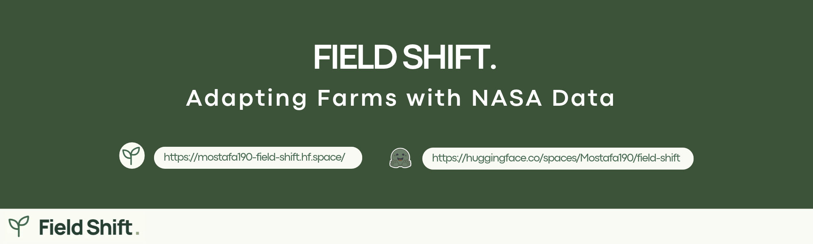
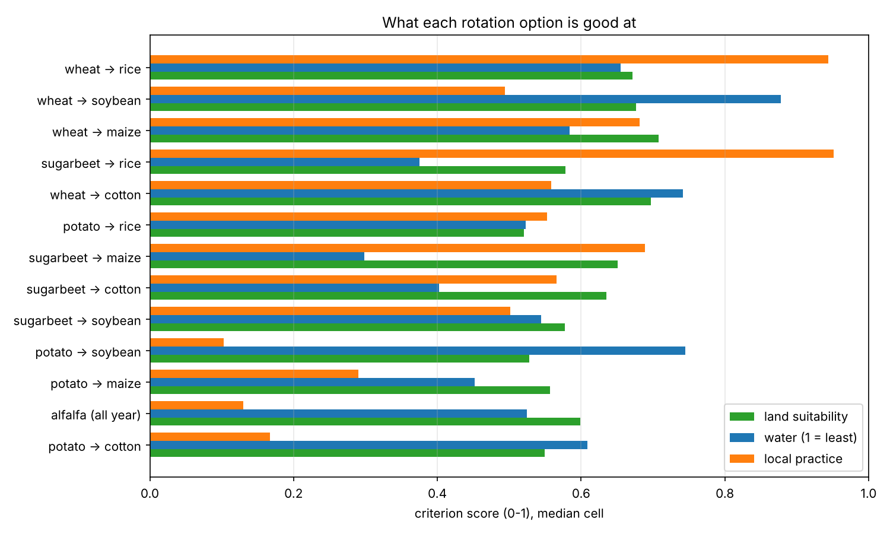
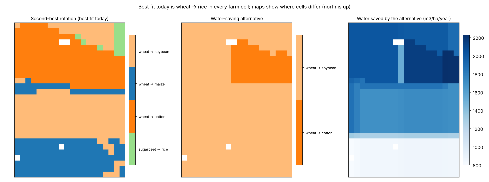

# Field Shift: Adapting Farms with NASA Data



**NASA Space Apps Challenge 2026, Cairo**
**Challenge:** Field Shift: Adapting Farms with NASA Data

Field Shift is a bilingual (Arabic/English) decision-support website that helps farmers and agricultural advisors in the Nile Delta compare crop-rotation options. It combines NASA Earth observations with soil, crop-suitability, and local-practice data into one transparent comparison.

> Field Shift supports farmers' decisions. It does not replace local agricultural expertise.

---

## What it does

For a selected farming cell in the pilot area, the system compares **13 crop-rotation options** across three criteria:

- **Land suitability**
- **Water requirement**
- **Local practice**

Users can change how much each criterion matters, and the ranking updates immediately. Every score can be traced back to its data source.

The 13 options use eight crops (wheat, sugarbeet, potato, maize, rice, cotton, soybean, alfalfa): a winter crop followed by a summer crop, plus an all-year alfalfa option.

## Pilot area

- **Location:** Sidi Salem and Qallin, west of Kafr El-Sheikh city, North Nile Delta, Egypt
- **Bounding box (W, S, E, N):** 30.70, 31.05, 30.91, 31.30
- **Size:** about 20 km by 28 km
- **Analysis grid:** 560 cells (28 rows by 20 columns, about 1 km each), of which **556 are agricultural**

## Data sources

| Source | Role |
|---|---|
| NASA GPM IMERG | Rainfall |
| NASA SMAP | Soil-moisture-based irrigation-need indicator |
| NASA POWER | Temperature |
| NASA SRTM | Terrain and elevation |
| Landsat | Long-term vegetation context |
| ESA Sentinel-2 | Agricultural cover and vegetation indices |
| FAO GAEZ v5 | Crop suitability, soil constraints, local-practice fields |

The final cell table has 189 documented fields per cell. The backend checks file hashes and dataset structure at startup.

## How scoring works

Each rotation gets three component scores between 0 and 1. The final score is a weighted average:

`score = (w_land * land + w_water * water + w_practice * practice) / (w_land + w_water + w_practice)`

The default uses equal weights. The score compares options. It is **not** a probability of success or a yield forecast. It is an explainable calculation, not a black-box AI model.

## Website features

- Overview with map, vegetation history, and the leading rotation
- My Farms: save farms with name, area (feddans), and location
- Crop Insights: top-three comparison and the full ranking of 13 options
- Farm Planner: a checklist for each farm
- Adjustable scoring weights, Arabic (right-to-left) and English, three color themes
- Science view with sources, formula, and limits
- JSON report export

## Project structure

- `website-v2/index.html`, `css/`, `js/`: the dashboard (HTML, CSS, JavaScript)
- `website-v2/backend/app/`: FastAPI backend and scoring service
- `website-v2/backend/data/`: the four processed data tables and the manifest
- `website-v2/backend/tests/`: automated tests (20 passing)

## File structure


[](https://gitdiagram.com/mostafaai10/field-shift-adapting-farms-with-nasa-data-2026?utm_source=readme&utm_medium=picture)

## Run it locally

From the `website-v2/backend` folder:

```
python -m venv .venv
.venv\Scripts\activate
pip install -r requirements.lock.txt
python -m pytest
python -m uvicorn app.main:app --host 127.0.0.1 --port 8000
```

Then open http://127.0.0.1:8000 in your browser. (On macOS or Linux, activate with `source .venv/bin/activate`.)

## Limitations

- Coverage is limited to the pilot area, not all of Egypt.
- A cell (about 1 km) is not a farm parcel.
- Data is historical. There is no live NASA ingestion yet.
- Irrigation amounts are modeled estimates, not measured water use.
- The local-practice score uses area-level 2020 statistics, not an individual farmer's current rotation.
- Yield, income, and water-saving improvements are not claimed. They would need field trials.
- Saved farms and tasks are stored in the user's browser only.

## Team

- **Mostafa Abdelhamed:** data work and supervision
- **Omar, Fatma, Mostafa Nabil:** data work
- **Ahmed:** demo website and scoring system
- **Kareem:** testing, presentation, and video demo


## Results

### Criteria scores by rotation option



### Recommendation maps


